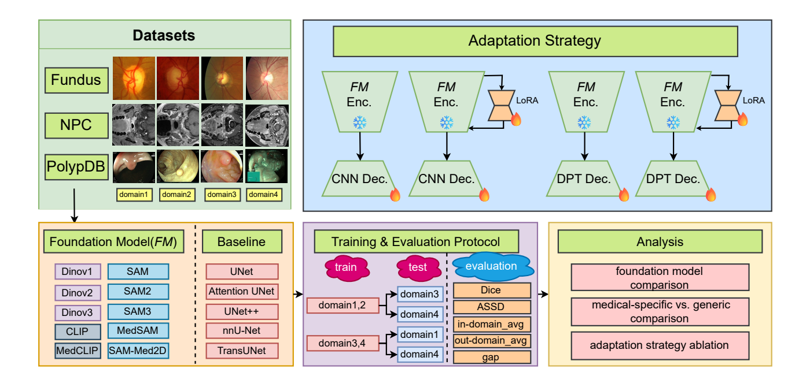

# FMDG-Bench

**A Benchmark for Domain Generalizability of Foundation Models in Medical Image Segmentation After Adaptation**

[Yahang Feng](mailto:), Kaixuan Yang, Wenzhe Zhao, Jiaxian Wang, Jie Xu, Guotai Wang

School of Mechanical and Electrical Engineering, University of Electronic Science and Technology of China;
West China Second University Hospital, Sichuan University; West China Hospital, Sichuan University;
Shanghai Artificial Intelligence Laboratory

Maintained by the [HiLab-git](https://github.com/HiLab-git) organization.

<p align="center">
  
</p>

<p align="center"><sub>
Overview of FMDG-Bench: the three multi-domain datasets, the ten foundation models and
five baseline networks, the four adaptation strategies (CNN / DPT decoders, with and
without LoRA), the training and evaluation protocol, and the analyses reported in the
paper. PDF version: <a href="assets/workflow.pdf">assets/workflow.pdf</a>.
</sub></p>

## News

- **[2026-11]** Code and benchmark protocols released. Paper coming soon.

## Overview

**FMDG-Bench** systematically evaluates how well foundation models (FMs) generalize
across imaging domains *after* they have been adapted to a downstream medical
segmentation task.

- **3 multi-domain datasets** — Fundus (optic cup / disc, 4 scanners), NPC MRI
  (4 acquisition protocols), PolypDB (4 endoscopic imaging modalities).
- **10 foundation models** — DINO, DINOv2, DINOv3, CLIP, MedCLIP, SAM, SAM2, SAM3,
  MedSAM, SAM-Med2D (ViT-B backbones for all).
- **5 baseline networks** — UNet, Attention UNet, UNet++, nnU-Net, TransUNet.
- **4 adaptation strategies** — CNN decoder, DPT decoder, CNN decoder + LoRA,
  DPT decoder + LoRA (encoders frozen unless LoRA is enabled).
- **Protocol** — the four domains of each dataset are split into two groups
  (D1 + D2 vs. D3 + D4). Models are trained on one group and tested on the other,
  and vice versa; each domain is further split 80/20 for training/testing.
  In-domain (seen) and out-of-domain (unseen) Dice and ASSD are reported,
  together with the generalization gap `gap = Mean_in - Mean_out`.

| Dataset | Task | Domains | Metric |
|---|---|---|---|
| Fundus | Optic cup & optic disc segmentation | 4 scanners / institutions | Dice, ASSD |
| NPC | Nasopharyngeal carcinoma GTV segmentation (2D slices) | 4 MRI protocols | Dice, ASSD |
| PolypDB | Colonoscopy polyp segmentation | 4 imaging modalities (BLI / FICE / LCI / NBI) | Dice, ASSD |

## Repository structure

```
FMDG-Bench/
├── models/
│   ├── sam3/                 # SAM3 pipeline (CNN / DPT decoders, ± LoRA)
│   ├── sam2/                 # SAM2 pipeline
│   ├── medsam/               # SAM and MedSAM pipeline (*_16 scripts)
│   ├── clip/                 # CLIP and MedCLIP pipeline (*_new scripts)
│   ├── dino/                 # DINOv1 / DINOv2 / DINOv3 pipeline
│   └── baselines/
│       ├── unet/             # UNet, full-parameter training (MONAI UNet)
│       ├── trainer/          # UNet++ / Attention UNet / TransUNet / nnU-Net wrappers
│       └── nnunet/           # nnU-Net training pipeline
├── envs/                     # conda environment + environment notes
├── docs/                     # installation, data, reproduction, repository notes
├── tools/                    # environment self-check
└── assets/                   # figures used in this README
```

Every model family is a **self-contained directory**: it vendors the small shared
modules it needs (`segment_anything`, `seg_head`, `Datasets`, dataset loaders), so
you can `cd` into it and run without touching the other folders. This duplicates a
few small files on purpose — see [docs/repository.md](docs/repository.md).

## Installation

We provide a single conda environment for the SAM3 / SAM2 / SAM / MedSAM /
DINO / baseline pipelines:

```bash
conda env create -f envs/environment.yml
conda activate fmdg-bench
```

Run the self-check to see which model families your environment covers:

```bash
python tools/check_env.py
```

**Known gaps of the provided environment** (see [envs/README.md](envs/README.md)):

| Requirement | Why | Install |
|---|---|---|
| `clip` (OpenAI) | `models/clip/*_new.py` does `import clip` | `pip install git+https://github.com/openai/CLIP.git` |
| `transformers` | MedCLIP / CLIP vision towers | `pip install "transformers>=4.40"` |
| `wandb` | `models/sam3/*` and `models/baselines/trainer/train.py` log to W&B | `pip install wandb` |
| `nnunetv2` | `models/baselines/nnunet` | `pip install nnunetv2` (usually a separate environment) |

The environment was exported from the lab server (`Fsam3`) and validated on the
SAM3 pipeline. CLIP/MedCLIP and nnU-Net were run in separate environments during
the experiments; see [docs/install.md](docs/install.md) for details and for notes
on CUDA 12.6 wheels and on GPUs without bfloat16 support (e.g. GTX 1080Ti).

## Data preparation

Datasets are **not** redistributed in this repository. Please obtain them from the
original sources (Drishti-GS, RIM-ONE-r3, REFUGE, the NPC MRI dataset, PolypDB)
and arrange them as described in [docs/data.md](docs/data.md):

```
$FMDG_DATA_ROOT/
├── Fundus/                  # four domains, each with train/test splits
├── NPC/preprocessed/        # 2D slices + masks
└── PolypDB/                 # four imaging modalities
```

The entry scripts expect two environment variables:

```bash
export FMDG_DATA_ROOT=/path/to/FMDG-data
export FMDG_WORK_DIR=/path/to/outputs       # checkpoints, logs, predictions
```

## Quick start

Each family has its own `README.md` with details. All commands assume
`conda activate fmdg-bench`, and that the working directory is the family folder.

**SAM3** (also see `models/sam3/run.sh` for the full 12-run grid):

```bash
cd models/sam3
mkdir -p logs
python cnn_sam3_Fundus.py --data_root $FMDG_DATA_ROOT/Fundus \
    --trainid 1,3 --testid 2,4 --work_dir $FMDG_WORK_DIR \
    --task_name sam3_cnn_fu --num_epochs 50 --device cuda:0
```

**SAM / MedSAM** (`*_16` scripts; `models/medsam/run_16.sh` lists all runs):

```bash
cd models/medsam
python sam_DPT_fundus_16.py --data_root $FMDG_DATA_ROOT/Fundus \
    --trainid 1,3 --testid 2,4 --work_dir $FMDG_WORK_DIR \
    --task_name sam_DPT_fu --num_epochs 50 --device cuda:0
```

**SAM2**: `cd models/sam2 && python cnn_sam2_NPC.py --data_root ...` (see `run.sh`).

**CLIP / MedCLIP** (`*_new` scripts; need the `clip` package):

```bash
cd models/clip
python clip_cnn_Fundus_new.py --data_dir $FMDG_DATA_ROOT/Fundus --dataset fundus \
    --trainid 1,3 --testid 2,4 --epochs 50 --batch_size 4 --num_classes 3 \
    --task_name clip_cnn_fu
```

**DINOv1 / v2 / v3** (`--dino_ckpt` points to the pretrained backbone):

```bash
cd models/dino
python train_dinov1_D_Fundus.py --data_dir $FMDG_DATA_ROOT/Fundus \
    --dino_ckpt /path/to/dinov1_vitb16.pth --dino_size b --epochs 50
```

**Baselines**:

```bash
cd models/baselines/trainer
python train.py --data_root $FMDG_DATA_ROOT/Fundus --trainid 1,3 --testid 2,4 \
    --model_type transunet --work_dir $FMDG_WORK_DIR --num_epochs 50

cd models/baselines/unet
python UNet.py --data_root $FMDG_DATA_ROOT/Fundus --trainid 1,3 --testid 2,4 \
    --work_dir $FMDG_WORK_DIR --num_epochs 50
```

The full run grid (dataset × model × adaptation strategy) and the commands used to
produce the paper tables are listed in [docs/reproduce.md](docs/reproduce.md).

## Results

The paper reports, for every dataset and every model, in-domain and out-of-domain
Dice and ASSD together with the generalization gap. The per-model numbers are
averaged over the four adaptation strategies. Tables are released with the paper;
training logs and predictions are produced under `$FMDG_WORK_DIR`.

## Citation

```bibtex
@article{feng2026fmdg,
  title   = {FMDG-Bench: A Benchmark for Domain Generalizability of Foundation
             Models in Medical Image Segmentation After Adaptation},
  author  = {Feng, Yahang and Yang, Kaixuan and Zhao, Wenzhe and Wang, Jiaxian
             and Xu, Jie and Wang, Guotai},
  journal = {arXiv preprint},
  year    = {2026}
}
```

See also [CITATION.cff](CITATION.cff).

## License

The code in this repository is released under the MIT License (see [LICENSE](LICENSE)).
Vendored third-party code keeps its original license — SAM3 (SAM License), SAM2
(Apache-2.0), DINOv2 (Apache-2.0), DINOv3 (DINOv3 License), CLIP (MIT), nnU-Net
(Apache-2.0). See [THIRD_PARTY_LICENSES.md](THIRD_PARTY_LICENSES.md). The datasets
follow their own licenses and are **not** included here.

## Acknowledgement

We thank the authors of SAM, SAM2, SAM3, MedSAM, SAM-Med2D, CLIP, MedCLIP,
DINOv2, DINOv3, MONAI, nnU-Net and TransUNet for releasing their code and weights.
